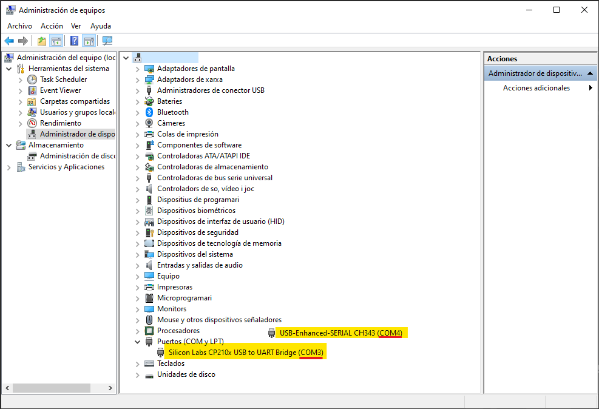
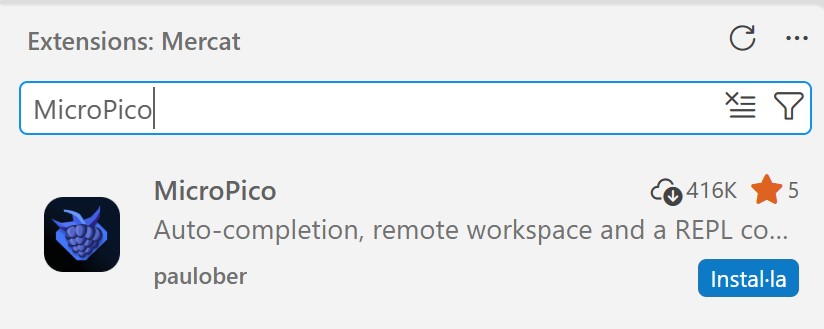

# Introducció a l'ESP32-S3 amb MicroPython i Visual Studio Code

Començarem programant amb [MicroPython][]{target="_blank"}, una implementació lleugera i optimitzada del llenguatge Python 3 dissenyada específicament per funcionar en microcontroladors i entorns amb recursos restringits.

Treballarem sobre plaques **[ESP32-S3][]**, un microcontrolador de doble nucli amb connectivitat Wi-Fi i Bluetooth integrada, ideal per a projectes d'IoT.

La placa es connecta mitjançant un cable USB a l'ordinador. Mitjançant **Visual Studio Code** i l'extensió **[MicroPico][]**, podrem carregar els nostres scripts, veure la consola en temps real (REPL) i gestionar els fitxers directament a la memòria flash de la placa.

---

## Prerequisits i instal·lació

Per començar a treballar cal seguir aquests tres passos:

1. Instal·lar els drivers de connexió USB.
2. Instal·lar l'extensió **MicroPico** a VS Code.
3. Configurar l'autocompletat (*stubs*) per a MicroPython.

### 1. Controladors USB (Drivers)

Segons el model exacte de la vostra placa ESP32-S3, la connexió USB es realitzarà directament a través del controlador integrat del xip o mitjançant un xip de sortida sèrie (com el CP210x o CH340).

* Per a plaques amb xip **Silicon Labs CP210x**: descarregueu el `CP210x Universal Windows Driver` des de la [pàgina oficial de Silicon Labs][pàgina de descàrregues de Silicon Labs]{target="_blank"}. Descomprimiu el fitxer, feu clic dret sobre `silabser.inf` i seleccioneu **Instal·lar**.

[![driver001.png][]][driver001.png]{target="_blank"}

Després de connectar la placa, quan connectem el dispositiu `ESP32` al port USB, podeu comprovar el port assignat (**COM3**, **COM4**, etc.) a l'**Administrador de dispositius** de Windows.



---

### 2. Configuració de Visual Studio Code: MicroPico

En lloc d'eines antigues com Pymakr, utilitzarem l'extensió **MicroPico** (mantinguda per Paul Oberhauser), que ofereix un entorn estable i modern per a MicroPython.

1. Obriu **Visual Studio Code**.
2. Aneu a la secció d'**Extensions** (`Ctrl+Shift+X`).
3. Cerqueu **MicroPico** i feu clic a **Install**.



---

## Crear i configurar un projecte amb MicroPico

### Pas 1: Inicialitzar el projecte

1. Obriu una carpeta buida a VS Code (`File > Open Folder...`).
2. Obriu la paleta de comandes de VS Code (`Ctrl+Shift+P`).
3. Escriviu i seleccioneu: **`MicroPico: Configure Project`**.

Aquesta acció crearà automàticament la configuració necessària per al projecte i descarregarà els *stubs* d'autocompletat per a MicroPython.

### Pas 2: Connectar amb la placa

1. Connecteu la placa ESP32-S3 al port USB.
2. A la barra d'estat inferior de VS Code, cliqueu sobre **`MicroPico > Connect`** (o bé executeu la comanda `MicroPico: Connect` des de `Ctrl+Shift+P`).
3. S'obrirà un terminal anomenat **MicroPico REPL** on podreu interactuar directament amb la consola de MicroPython.

---

## Estructura dels fitxers

Dins del vostre projecte trobareu o haureu de crear la següent estructura bàsica:

```
EL_TEU_PROJECTE/
├── .vscode/          # Configuració de l'entorn i stubs de MicroPico
├── boot.py           # S'executa sempre en arrencar el xip (configuracions de xarxa, etc.)
└── main.py           # El vostre codi principal (s'executa just després de boot.py)
```

!!! tip "Diferència entre boot.py i main.py"

    - `boot.py`: S'utilitza per a tasques d'inicialització del sistema (com connectar-se al Wi-Fi).

    - `main.py`: És el programa principal on escriurem la lògica de la nostra aplicació.

---

## Primer programa: Prova del LED RGB

A les plaques ESP32-S3 habituals, el LED integrat no és un LED tradicional sinó un **NeoPixel (WS2812)** connectat habitualment al pin **GPIO 48**.

Creeu o editeu el fitxer `main.py` amb el següent codi:

=== "ESP32-S3 (LED RGB NeoPixel)"

    ```py title="main.py"
    import machine
    import neopixel
    from time import sleep_ms

    # En la majoria de plaques ESP32-S3 el LED NeoPixel integrat està al GPIO 48
    PIN_NUM = 48
    NUM_PIXELS = 1

    np = neopixel.NeoPixel(machine.Pin(PIN_NUM), NUM_PIXELS)

    # Parpelleig en seqüència: Vermell, Verd, Blau
    for _ in range(5):
        np[0] = (255, 0, 0)  # Vermell
        np.write()
        sleep_ms(500)

        np[0] = (0, 255, 0)  # Verd
        np.write()
        sleep_ms(500)

        np[0] = (0, 0, 255)  # Blau
        np.write()
        sleep_ms(500)

    # Apagar el LED en acabar
    np[0] = (0, 0, 0)
    np.write()
    ```

=== "ESP32 DevKit V1 (LED integrat estàndard)"

    ```py title="main.py"
    from machine import Pin
    from time import sleep_ms

    # En les plaques ESP32 normals el LED integrat sol ser el GPIO 2
    led = Pin(2, Pin.OUT)

    for _ in range(10):
        led.value(1)  # Encendre
        sleep_ms(500)
        led.value(0)  # Apagar
        sleep_ms(500)

    led.value(0)
    ```

### Com pujar i executar el codi a la placa?

Amb MicroPico teniu dues opcions principals des de la barra inferior o la paleta de comandes (`Ctrl+Shift+P`):

* **`MicroPico: Run current file on target`**: Executa el fitxer obert a la memòria RAM de la placa sense desar-lo permanentment. Útil per fer proves ràpides.
* **`MicroPico: Upload project to target`**: Copia tots els fitxers del projecte (`main.py`, `boot.py`, etc.) a la memòria Flash de l'ESP32-S3. Quan reinicieu o desconnecteu la placa, el codi es mantindrà i s'executarà automàticament.

---

## Manteniment del Firmware: Instal·lació de MicroPython

Si la vostra placa ESP32-S3 no té el firmware carregat o cal actualitzar-lo, podeu reinstal·lar-lo fàcilment utilitzant l'eina `esptool`.

### 1. Instal·lar esptool

Des del terminal del vostre sistema operatiu:

=== "Windows (py)"

    ```doscon
    py -m pip install esptool
    ```

=== "Linux / macOS (pip)"

    ```bash
    pip install esptool
    ```

### 2. Passos per Flashear l'ESP32-S3

1. Descarregueu el fitxer `.bin` corresponent a la vostra placa des de la [pàgina de descàrregues de MicroPython per a ESP32-S3][ESP32-S3]{target="_blank"}.
2. Identifiqueu el port COM assignat (ex. `COM3`).
3. Netegeu la memòria flash existent:

    ```doscon
    py -m esptool -p COM3 erase_flash
    ```

4. Escriviu la nova imatge de MicroPython:

    ```doscon
    py -m esptool -p COM3 --baud 460800 write_flash 0 ESP32_GENERIC_S3-SPIRAM_OCT-20250911-v1.26.1.bin
    ```

!!! danger "Atenció amb la direcció de memòria!"

    En les plaques **ESP32-S3**, l'adreça d'inici sol ser `0` (`0x0000`), a diferència d'algunes plaques ESP32 antigues que utilitzaven `0x1000`. Verifiqueu sempre les instruccions específiques de la versió de firmware descarregada a la web de MicroPython.

??? example "Exemple de sortida correcta d'esptool"

    ```text
    esptool.py v4.7.0
    Serial port COM3
    Connecting....
    Chip is ESP32-S3 (QFN56) (revision v0.2)
    Features: WiFi, BLE, Embedded PSRAM 8MB (AP_3v3)
    Crystal is 40MHz
    MAC: e8:06:90:a1:25:58
    Uploading stub...
    Running stub...
    Stub running...
    Changing baud rate to 460800...
    Changed.
    Configuring flash size...
    Flash will be erased from 0x00000000 to 0x001a8fff...
    Wrote 1738912 bytes (1139405 compressed) at 0x00000000 in 26.3 seconds (528.0 kbit/s).
    Hash of data verified.

    Hard resetting via RTS pin...
    ```

---

## Enllaços de referència i documentació

* [Documentació Oficial de MicroPython][Documentació de MicroPython]{target="_blank"}
* [Repositori de l'extensió MicroPico][MicroPico Extension]{target="_blank"}
* [Documentació de l'eina esptool][esptoolDoc]{target="_blank"}

[MicroPython]:                              https://micropython.org/
[ESP32-S3]:                                 https://micropython.org/download/ESP32_GENERIC_S3/
[Documentació de MicroPython]:              https://docs.micropython.org/en/latest/
[pàgina de descàrregues de Silicon Labs]:   https://www.silabs.com/developers/usb-to-uart-bridge-vcp-drivers?tab=downloads
[esptoolDoc]:                               https://docs.espressif.com/projects/esptool/en/latest/esp32s3/
[MicroPico Extension]:                      https://marketplace.visualstudio.com/items?itemName=paulober.pico-w-go
[ESP32-S3]:                                 https://micropython.org/download/ESP32_GENERIC_S3/    "ESP32-S3"
[MicroPico]:                                https://marketplace.visualstudio.com/items?itemName=paulober.pico-w-go


--8<-- ".acronims.txt"
