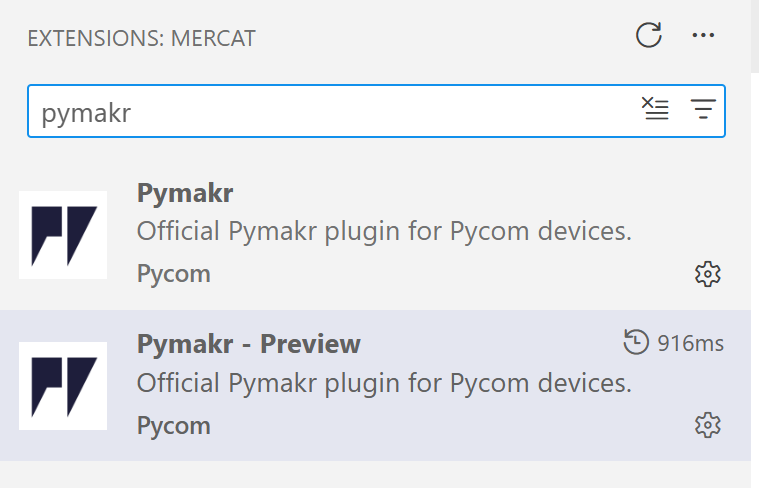

# Introducció a l'ESP32-S3 amb MicroPython i Visual Studio Code

Començarem programant amb [MicroPython](https://micropython.org/){target="_blank"}, una implementació lleugera i optimitzada del llenguatge Python 3 dissenyada específicament per funcionar en microcontroladors i entorns amb recursos restringits.

Treballarem sobre plaques **[ESP32-S3](https://micropython.org/download/ESP32_GENERIC_S3/)**, un microcontrolador de doble nucli amb connectivitat Wi-Fi i Bluetooth integrada, ideal per a projectes d'IoT.

La placa es connecta mitjançant un cable USB a l'ordinador. Mitjançant **Visual Studio Code** i l'extensió **[Pymakr](https://marketplace.visualstudio.com/items?itemName=pycom.Pymakr)**, podrem carregar els nostres scripts, veure la consola en temps real (REPL) i gestionar els fitxers directament a la memòria flash de la placa.

---

## Prerequisits i instal·lació

Per poder treballar amb aquestes plaques des de l'ordinador caldrà:

1. Que el nostre ordinador s'hi pugui connectar a través del port USB (Drivers).

2. Tenir el software adequat (*Visual Studio Code* + *Pymakr*) per comunicar-nos amb la placa i transferir els fitxers.

### 1. Controladors USB (Drivers)

Segons el model exacte de la vostra placa ESP32-S3, la connexió USB es realitzarà directament a través del controlador integrat del xip o mitjançant un xip de conversió sèrie (com el CP210x o CH340).

* Per a plaques amb xip **Silicon Labs CP210x**: descarregueu el `CP210x Universal Windows Driver` des de la [pàgina oficial de Silicon Labs](https://www.silabs.com/developers/usb-to-uart-bridge-vcp-drivers?tab=downloads){target="_blank"}. Descomprimiu el fitxer, feu clic dret sobre `silabser.inf` i seleccioneu **Instal·lar**.

[![driver001.png][]][driver001.png]{target="_blank"}

Una vegada instal·lat el driver, quan connectem el dispositiu ESP32-S3 al port USB, cal comprovar en quin port se'ns ha assignat. Ho comprovarem a l'**Administrador de dispositius** de Windows, on apareixerà mapejat a un port tipus **COM3** o **COM4**.

[![driver002.png][]][driver002.png]{target="_blank"}

---

### 2. Visual Studio Code i extensions Pymakr

Dins de **Visual Studio Code**, anirem a la secció d'**Extensions** (`Ctrl+Shift+X`) i cercarem:

* **Pymakr** (de Pycom)



Una vegada instal·lada, veurem la icona de Pymakr a la barra lateral esquerra de VS Code, des d'on podrem gestionar els dispositius connectats i els nostres projectes.

---

## Crear el primer projecte amb Pymakr

Per començar a programar la placa:

1. Dins de VS Code, accediu a la pestanya de l'extensió **Pymakr**.

2. Creeu un nou projecte escollint la opció **Create Project** / **Empty Project**.

3. Seleccioneu la carpeta de treball on voleu desar els vostres programes.

A l'explorador de fitxers de VS Code es crearà una estructura com aquesta:

```text
C:\ASIX\IOT\PROJECTE-01\
├── boot.py
├── main.py
└── pymakr.conf
```

```json title="pymakr.conf"
{
    "name": "Projecte ESP32-S3"
}
```

```python title="boot.py"
# boot.py -- S'executa sempre en arrencar el xip
```

```python title="main.py"
# main.py -- Posa el teu codi principal aquí!
```

---

## Primer programa: Prova del LED RGB (NeoPixel)

A les plaques **ESP32-S3**, el LED integrat a la placa acostuma a ser un LED d'alta lluminositat programable tipus **NeoPixel (WS2812)** connectat habitualment al pin **GPIO 48**.

Editeu el fitxer `main.py` amb el següent codi segons el model de la vostra placa:

=== "ESP32-S3 (LED RGB NeoPixel)"

    ```python title="main.py"
    import machine
    import neopixel
    from time import sleep_ms

    # En la majoria de plaques ESP32-S3 el LED NeoPixel integrat està al GPIO 48
    PIN_NUM = 48
    NUM_PIXELS = 1

    np = neopixel.NeoPixel(machine.Pin(PIN_NUM), NUM_PIXELS)

    # Parpelleig en seqüència: Vermell, Verd, Blau
    for _ in range(5):
        np[0] = (255, 0, 0)  # Vermell
        np.write()
        sleep_ms(500)

        np[0] = (0, 255, 0)  # Verd
        np.write()
        sleep_ms(500)

        np[0] = (0, 0, 255)  # Blau
        np.write()
        sleep_ms(500)

    # Apagar el LED en acabar
    np[0] = (0, 0, 0)
    np.write()
    ```

=== "DEV KIT V1 (LED integrat estàndard)"

    ```python title="main.py"
    from machine import Pin
    from time import sleep_ms

    # En les plaques ESP32 tradicionals el LED integrat sol ser el GPIO 2
    led = Pin(2, Pin.OUT)

    for _ in range(10):
        led.value(1)  # Encendre
        sleep_ms(500)
        led.value(0)  # Apagar
        sleep_ms(500)

    led.value(0)
    ```

---

## Manteniment del Firmware: Carregar MicroPython amb `esptool`

Si la placa no té el firmware de MicroPython o cal actualitzar-lo, podem utilitzar el mòdul de Python `esptool`.

### 1. Instal·lació d'esptool

=== "Windows (py)"

    ```doscon
    py -m pip install esptool
    ```

=== "Linux / macOS (pip)"

    ```bash
    pip install esptool
    ```

### 2. Passos per Flashear l'ESP32-S3

1. Descarregueu la imatge `.bin` adequada des de la [pàgina de descàrregues de MicroPython per a ESP32-S3](https://micropython.org/download/ESP32_GENERIC_S3/){target="_blank"}.
2. Identifiqueu el port assignat a l'Administrador de Dispositius (ex. `COM3`).
3. Esborreu la memòria flash existent:

    ```doscon
    py -m esptool -p COM3 erase_flash
    ```

4. Escriviu el nou firmware de MicroPython:

    ```doscon
    py -m esptool -p COM3 --baud 460800 write_flash 0 ESP32_GENERIC_S3-SPIRAM_OCT-20250911-v1.26.1.bin
    ```

!!! danger "Atenció amb la direcció de memòria!"
    A les plaques **ESP32-S3**, l'adreça d'inici sol ser `0` (`0x0000`), a diferència d'algunes plaques ESP32 anteriors que utilitzaven `0x1000`. Verifiqueu sempre les instruccions específiques de la versió de firmware descarregada.

??? example "Exemple de sortida de la càrrega de la flash"

    ```doscon
    esptool v4.7.0
    Serial port COM3
    Connecting....
    Chip is ESP32-S3 (QFN56) (revision v0.2)
    Features: WiFi, BLE, Embedded PSRAM 8MB (AP_3v3)
    Crystal is 40MHz
    MAC: e8:06:90:a1:25:58
    Uploading stub...
    Running stub...
    Changing baud rate to 460800...
    Changed.
    Configuring flash size...
    Flash will be erased from 0x00000000 to 0x001a8fff...
    Wrote 1738912 bytes (1139405 compressed) at 0x00000000 in 26.3 seconds (528.0 kbit/s).
    Hash of data verified.

    Hard resetting via RTS pin...
    ```

---

## Documentació i enllaços de referència

* [Documentació Oficial de MicroPython](https://docs.micropython.org/en/latest/){target="_blank"}
* [Pàgina oficial d'Espressif (ESP32-S3)](https://www.espressif.com/en/products/socs/esp32-s3){target="_blank"}
* [Documentació de l'eina esptool](https://docs.espressif.com/projects/esptool/en/latest/esp32s3/){target="_blank"}

[driver001.png]:    ./img/driver001.png "CP210x"
[driver002.png]:    ./img/driver002.png "Administració de dispositius"

--8<-- ".acronims.txt"
