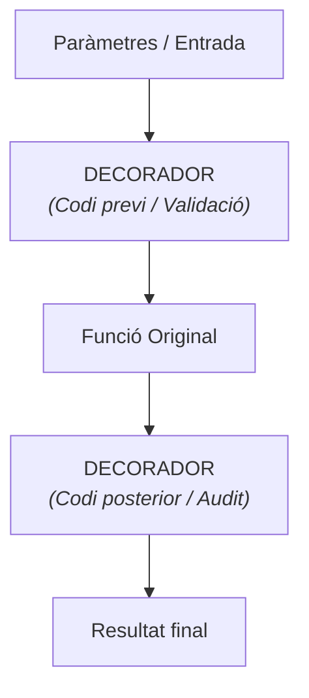

# Decoradors en Python (`@`)

Quan treballem amb scripts avançats d'administració de sistemes, automatització o _frameworks web_ (com Flask o FastAPI), és molt habitual trobar-nos amb una línia que comença amb el símbol `@` just a sobre de la definició d'una funció.

Aquesta sintaxi s'anomena **_Decorador_**.

## 1. Què és un Decorador?

Un **decorador** és una funció especial que agafa una altra funció com a entrada i en **modifica o amplia el seu comportament** sense haver de canviar-ne el codi font intern.

L'analogia més fàcil és pensar en un **embolcall** o una **capa de seguretat/control**:

* La funció original fa la tasca principal (ex: _fer una còpia de seguretat_).

* El decorador afegeix una capa extra al voltant (ex: _comprovar permisos abans d'executar_, _mesurar quant triga_ o _escriure un log en acabar_).



## 2. On ens trobarem els decoradors?

Com a administradors de sistemes, utilitzarem decoradors contínuament en llibreries de tercers:

1. **Rutes en Serveis Web / APIs (Flask / FastAPI)**:

    ```py
    @app.route("/api/v1/servidors")
    def llistar_servidors():
        return {"servidors": ["srv-db", "srv-web"]}
    ```

2. **Control d'Accés i Autenticació**:

    ```py
    @functools.lru_cache(maxsize=128)
    def consultar_dns_lent(domini):
        # Consulta DNS pesada
        pass
    ```

### 3. Creem el nostre primer Decorador

Per crear un decorador necessitem definir una funció que en tingui una altra a dins (_funció anidada_).

Imaginem que volem un decorador que mesuri automàticament **quant temps triga a executar-se qualsevol tasca de sistemes**:

### 3. Creem el nostre primer Decorador

Per crear un decorador necessitem definir una funció que en tingui una altra a dins (_funció anidada_).

Imaginem que volem un decorador que mesuri automàticament **quant temps triga a executar-se qualsevol tasca de sistemes**:

```py hl_lines="6 11-13" linenums="1"
import time

# 1. Definició del decorador
def mesurar_temps(funcio_original):
    def embolcall(*args, **kwargs):
        inici = time.time()
        
        # Executem la funció original amb els seus arguments
        resultat = funcio_original(*args, **kwargs)
        
        fi = time.time()
        temps_total = fi - inici
        print(f"⏱️ [LOG TEMPS] La funció '{funcio_original.__name__}' ha trigat {temps_total:.2f} segons.")
        
        return resultat
        
    return embolcall

# 2. Aplicació del decorador amb la sintaxi '@'
@mesurar_temps
def fer_backup_sistema(directori):
    print(f"Iniciant còpia de seguretat de {directori}...")
    time.sleep(2)  # Simulem un procés que triga 2 segons
    print(" Còpia de seguretat completada.")

# 3. Execució normal
fer_backup_sistema("/var/www/html")
```

En aquest codi trobem ressaltades les línies que s'executen abans (línia 6) i després (línies 11 a 13) de la funció principal. Aquestes línies són precisament les que haurem de modificar segons quina sigui la nova funcionalitat que vulguem afegir amb la decoració.

## Exercici Pràctic: Decorador d'Auditoria d'Execució

Crea un decorador anomenat `@auditar_execucio` que s'apliqui a qualsevol funció d'administració de sistemes.

El decorador ha de:

1. Imprimir per pantalla el missatge: "`[AUDITORIA] S'està executant la funció: <nom_de_la_funció>`" abans de córrer la funció.

2. Executar la funció original.

3. Imprimir per pantalla el missatge: "`[AUDITORIA] Execució finalitzada amb èxit.`" desprès d'executar-la.

Aplica aquest decorador a una funció fictícia anomenada `reiniciar_servei(nom_servei)` que simuli la reiniciada d'un servei (ex: "`nginx`").

???example "Possible solució"

    ```py hl_lines="4 8 11 13 16"
    import time

    def auditar_execucio(funcio_original):
        def embolcall(*args, **kwargs):
            print(f"[AUDITORIA] S'està executant la funció: '{funcio_original.__name__}'")
            
            # Executem la funció original
            resultat = funcio_original(*args, **kwargs)
            
            print(f"[AUDITORIA] Execució de '{funcio_original.__name__}' finalitzada amb èxit.\n")
            return resultat
            
        return embolcall

    # Aplicació del decorador
    @auditar_execucio
    def reiniciar_servei(nom_servei):
        print(f"... Reiniciant el servei del sistema: {nom_servei}...")
        time.sleep(1)

    # Execució de la funció decorada
    reiniciar_servei("nginx")
    reiniciar_servei("mariadb")
    ```


--8<-- ".acronims.txt"
